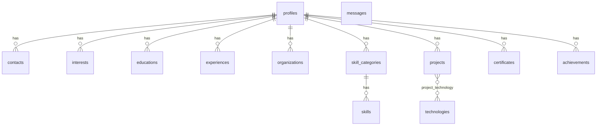

# 🧑‍💻 Portofolio Pribadi — Adindra Hakim Mulyawan

Website CV / portofolio pribadi berbasis **Laravel 12** untuk Tugas UTS Pemrograman Web. Seluruh konten profil (data diri, pendidikan, skill, project, sertifikat, kontak, dan lainnya) **dibaca dari database**, bukan ditulis langsung di view. Tampilannya gelap dan interaktif, dengan background animasi, kartu ID berfoto yang bisa diayun, serta form kontak yang benar-benar berfungsi.

---

## 🛠️ Teknologi yang Digunakan

* **Back-End:** PHP 8.2+, Laravel 12 (Eloquent ORM, Blade)
* **Database:** MySQL / MariaDB
* **Front-End:** HTML5, CSS3, JavaScript (Vanilla, tanpa framework), Canvas 2D
* **Font:** Inter (Google Fonts)
* **Tanpa library animasi pihak ketiga:** background, kartu lanyard, dan semua efek ditulis sendiri di `public/js/portfolio.js`

---

## ✅ Fitur yang Sudah Selesai

### 🗄️ Konten Dinamis dari Database
- [x] Semua isi halaman diambil lewat Eloquent dan dirender dengan `@foreach` di `resources/views/home.blade.php`.
- [x] Struktur tabel berelasi (one-to-many dan many-to-many), lihat bagian *Struktur Database*.
- [x] Bagian yang datanya kosong (sertifikat, pencapaian) otomatis disembunyikan.

### 🖥️ Halaman
- [x] **Home:** hero dengan teks peran yang mengetik, tombol Download CV / GitHub / LinkedIn, dan kartu ID berfoto (lanyard) dengan fisika tali yang bisa ditarik.
- [x] **About:** deskripsi, minat, dan riwayat pendidikan.
- [x] **Skills:** kartu skill dengan filter kategori.
- [x] **Projects:** kartu project dengan gambar, tag teknologi, jendela detail, dan tombol **Buka ↗** ke tautan project.
- [x] **Experience:** timeline pendidikan, pengalaman, dan organisasi dengan garis progres saat di-scroll.
- [x] **Certificates & Achievements:** sertifikat dengan pratinjau gambar dan daftar pencapaian.
- [x] **Contact:** kartu kontak dan form pesan.

### ✨ Animasi & Antarmuka
- [x] Background *flow field* bergaya topografi (ditulis native di Canvas), warnanya mengikuti tema.
- [x] Mode gelap / terang dengan tombol tema.
- [x] Loading screen, progress bar scroll, efek muncul saat di-scroll, kartu miring (*tilt*), tombol magnetik, dan cincin kursor.
- [x] Mendukung *reduced motion* (animasi dikurangi otomatis) dan responsif untuk HP.

### 📬 Form Kontak Fungsional
- [x] Validasi dengan pesan error per kolom, pembatasan 5 kiriman per menit, dan perlindungan anti-bot (honeypot).
- [x] Pesan **disimpan di tabel `messages`** dan opsional dikirim ke email lewat SMTP.
- [x] **Inbox admin** di `/admin/messages` (login dari `.env`): balas lewat email, tandai dibaca, hapus.

### 🔎 Lain-lain
- [x] `robots.txt`, `sitemap.xml`, halaman 404 bertema, dan meta Open Graph.
- [x] Tautan detail project (`/projects/{slug}`) yang membuka jendela detail.

---

## 🗄️ Struktur Database



* **One-to-Many:** semua tabel konten memakai `profile_id` (*foreign key*, `ON DELETE CASCADE`); `skills` berelasi ke `skill_categories`.
* **Many-to-Many:** `projects` ↔ `technologies` lewat tabel pivot `project_technology`.
* `messages` menyimpan pesan dari form kontak (dengan kolom `is_read`).

---

## 🚀 Cara Menjalankan di Komputer Lokal (Laragon)

Prasyarat: PHP 8.2+, Composer, dan MySQL/MariaDB (sudah termasuk di Laragon).

1.  Clone atau salin project ke `C:\laragon\www\portofolio`, lalu buka terminal di folder itu:
    ```bash
    composer install
    cp .env.example .env
    php artisan key:generate
    ```
2.  Nyalakan Laragon (**Start All**), buka **phpMyAdmin**, lalu **Import** file `portofolio.sql` (file ini membuat database `portofolio` beserta datanya).

    ```
3.  Jalankan server, lalu buka `http://127.0.0.1:8000`:
    ```bash
    php artisan config:clear
    php artisan serve
    ```

> ⚠️ **Jangan** menjalankan `php artisan migrate` pada database yang dibuat dari `portofolio.sql` (tabelnya sudah ada), dan jangan menjalankan `migrate:fresh --seed` karena menghapus semua data yang sudah kamu edit.


## ✏️ Cara Mengubah Isi Portofolio

Semua isi diubah lewat database (phpMyAdmin), tanpa menyentuh kode:

| Yang diubah | Tabel |
|---|---|
| Nama, bio, About, peran | `profiles` |
| Email, GitHub, LinkedIn | `contacts` |
| Pendidikan / pengalaman / organisasi | `educations` / `experiences` / `organizations` |
| Skill | `skill_categories`, `skills` |
| Project dan teknologinya | `projects`, `technologies`, `project_technology` |
| Sertifikat dan pencapaian | `certificates`, `achievements` |

Contoh menambah project (tab **SQL** di phpMyAdmin):
```sql
INSERT INTO projects (profile_id, title, slug, category, icon, image_path, description, url, sort)
VALUES (1, 'Nama Project', 'nama-project', 'Web Application', '🚀',
        'images/projects/nama-project.png', 'Deskripsi singkat.', 'https://link-project', 4);
```
Aset diletakkan di folder `public/`: foto profil `images/profile.jpg`, gambar project `images/projects/`, gambar sertifikat `images/certificates/`, dan CV `cv/` (nama file sesuai kolom `cv_path`).

---

## 🌐 Hosting (cPanel)

1.  Pastikan PHP **8.2 atau lebih baru** (MultiPHP Manager).
2.  Unggah project **di luar** `public_html`, lalu arahkan *Document Root* subdomain ke folder `public`.
3.  Buat database di cPanel, lalu import **`portofolio-hosting.sql`** (versi tanpa `CREATE DATABASE`).
4.  Buat `.env` produksi (`APP_ENV=production`, `APP_DEBUG=false`, `APP_URL=https://...`, kredensial database cPanel, `SESSION_DRIVER=file`).
5.  Beri izin tulis untuk `storage/` dan `bootstrap/cache/`, lalu aktifkan HTTPS (AutoSSL).

> ⚠️ Jangan menjalankan `config:cache` maupun `route:cache`; sandi inbox dibaca langsung dari `.env` dan sebagian rute memakai closure.

---

## 📁 Struktur File Utama

```
app/
  Http/Controllers/   HomeController, ContactController, AdminController
  Http/Middleware/    AdminAuth (login inbox)
  Models/             Profile, Contact, Interest, Education, Experience, Organization,
                      SkillCategory, Skill, Project, Technology, Certificate, Achievement, Message
database/
  migrations/         struktur tabel
  seeders/            data awal (PortfolioSeeder)
public/
  css/portfolio.css   gaya halaman
  js/portfolio.js     animasi, background, lanyard, form kontak
  images/             foto profil, gambar project dan sertifikat
  cv/                 file CV
resources/views/
  home.blade.php      halaman utama (dirender dari database)
  admin/messages.blade.php   inbox pesan
  errors/404.blade.php
routes/web.php
```

---

## 👤 Pembuat

**Adindra Hakim Mulyawan** — Mahasiswa Teknik Informatika, Universitas Muhammadiyah Sukabumi (UMMI)

* GitHub: [adindrax-hub](https://github.com/adindrax-hub)
* LinkedIn: [Adindra Hakim Mulyawan](https://www.linkedin.com/in/adindra-hakim-mulyawan-7a2993393/)
