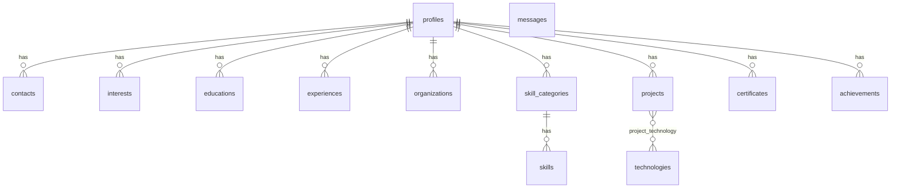

# 🧑‍💻 Portofolio Pribadi — Adindra Hakim Mulyawan

Website CV / portofolio pribadi berbasis **Laravel 12** dengan panel admin **Filament**, dibuat untuk Tugas UTS Pemrograman Web. Seluruh konten profil (data diri, pendidikan, skill, project, sertifikat, kontak, dan lainnya) **dibaca dari database**, bukan ditulis langsung di view, dan bisa diedit lewat panel admin.

🔗 **Live:** [https://adindra.informatics24c.my.id](https://adindra.informatics24c.my.id)

---

## 🛠️ Teknologi yang Digunakan

* **Back-End:** PHP 8.2+ (produksi memakai 8.3), Laravel 12 (Eloquent ORM, Blade)
* **Panel Admin:** Filament v3.3
* **Database:** MySQL / MariaDB
* **Front-End:** HTML5, CSS3, JavaScript murni (Canvas 2D untuk background dan kartu lanyard), font Inter
* **Email:** SMTP (Gmail atau email bawaan cPanel), opsional

> Halaman publik memakai CSS dan JS biasa di `public/css` dan `public/js`, jadi **tidak perlu `npm install` maupun `npm run build`**.

---

## ✅ Fitur

### 🖥️ Halaman Publik
- [x] **Home:** teks peran mengetik, tombol Download CV / GitHub / LinkedIn, dan kartu ID berfoto (lanyard) dengan fisika tali yang bisa ditarik.
- [x] **About, Skills (filter kategori), Projects (kartu, gambar, detail, tombol Buka ↗), Experience (timeline), Certificates & Achievements, dan Contact.**
- [x] Background alur garis topografi (Canvas), mode gelap/terang, loading screen, progress scroll, animasi muncul saat di-scroll, dan dukungan *reduced motion*.
- [x] Bagian yang datanya kosong (sertifikat, pencapaian) otomatis disembunyikan.
- [x] `robots.txt`, `sitemap.xml`, halaman 404, dan meta Open Graph.

### 📬 Form Kontak
- [x] Validasi per kolom, batas 5 kiriman per menit, dan perlindungan anti-bot (honeypot).
- [x] Pesan **disimpan di tabel `messages`**; notifikasi email bersifat opsional dan kegagalan SMTP tidak membuat form error.

### 🔐 Panel Admin (`/admin`)
- [x] Login Filament untuk mengelola profil, kontak, skill, project, teknologi, pendidikan, pengalaman, organisasi, sertifikat, pencapaian, dan **pesan masuk**.
- [x] Akses panel dibatasi lewat `FilamentUser::canAccessPanel()` di `app/Models/User.php` (wajib agar tidak 403 saat `APP_ENV=production`).

---

## 🗄️ Struktur Database



* **One-to-Many:** tabel konten memakai `profile_id` (*foreign key*, `ON DELETE CASCADE`); `skills` berelasi ke `skill_categories`.
* **Many-to-Many:** `projects` ↔ `technologies` lewat pivot `project_technology`.
* `messages` menyimpan pesan dari form kontak. Filament memakai tabel `users` untuk login admin.

---

## 🚀 Menjalankan di Komputer Lokal

Prasyarat: PHP 8.2+, Composer, dan MySQL/MariaDB (mis. Laragon).

```bash
git clone https://github.com/adindrax-hub/NAMA-REPO.git portofolio
cd portofolio
composer install
cp .env.example .env
php artisan key:generate
```

Buat database kosong bernama `portofolio`, atur `.env` (`DB_*`), lalu pilih salah satu:

* **Database baru lewat migration:**
  ```bash
  php artisan migrate --seed      # membuat semua tabel + data awal
  php artisan make:filament-user  # akun login panel admin
  ```
* **Atau import SQL:** import file `.sql` hasil export database ke phpMyAdmin.

Jalankan server:
```bash
php artisan serve
```
Halaman publik di `http://127.0.0.1:8000`, panel admin di `http://127.0.0.1:8000/admin`.

> ⚠️ Jangan menjalankan `migrate:fresh --seed` pada database yang isinya sudah kamu edit, karena semua data akan terhapus.

---

## 🌐 Deploy ke cPanel (ringkas)

1. Atur **MultiPHP Manager** ke PHP 8.3 (atau 8.2) untuk domain/subdomain, dan pastikan ekstensi `intl`, `zip`, `fileinfo`, `gd`, `mbstring`, `pdo_mysql`, dan `bcmath` aktif.
2. Buat subdomain dengan **Document Root** mengarah ke folder `public` project (project berada di luar `public_html`).
3. Buat database dan user di cPanel, lalu import database lewat phpMyAdmin.
4. Buat `.env` produksi:
   ```env
   APP_ENV=production
   APP_DEBUG=false
   APP_URL=https://domain-kamu
   DB_DATABASE=...
   DB_USERNAME=...
   DB_PASSWORD=...
   SESSION_DRIVER=database   # atau file; "database" butuh tabel sessions
   SESSION_SECURE_COOKIE=true
   FILESYSTEM_DISK=public
   ```
5. Buat symlink storage dan bersihkan cache (`php artisan storage:link`, `php artisan optimize:clear`).

**Keamanan:** `.env` tidak boleh masuk Git dan tidak boleh dibagikan. Sandi database, sandi aplikasi Gmail, dan `APP_KEY` jangan ditempel di chat atau dokumen publik; kalau pernah terlanjur, buat yang baru.

---

## 📁 Struktur File Utama

```
app/Filament/            resource panel admin
app/Http/Controllers/    HomeController, ContactController
app/Models/              Profile, Contact, Interest, Education, Experience, Organization,
                         SkillCategory, Skill, Project, Technology, Certificate,
                         Achievement, Message, User (FilamentUser)
database/migrations/     struktur tabel
database/seeders/        data awal (PortfolioSeeder)
public/css|js|images|cv  aset halaman publik
resources/views/         home.blade.php, errors/404.blade.php
routes/web.php           /, /projects/{slug}, /contact, robots.txt, sitemap.xml
```

---

## 👤 Pembuat

**Adindra Hakim Mulyawan** — Mahasiswa Teknik Informatika, Universitas Muhammadiyah Sukabumi (UMMI)

* GitHub: [adindrax-hub](https://github.com/adindrax-hub)
* LinkedIn: [Adindra Hakim Mulyawan](https://www.linkedin.com/in/adindra-hakim-mulyawan-7a2993393/)
